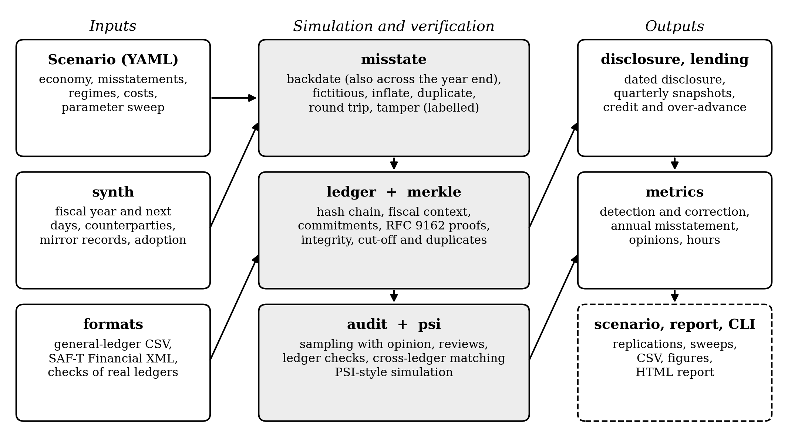

# VeriLedger

VeriLedger simulates how blockchain-based record keeping changes the verification of accounting
records and the information available to outsiders. It is designed for research on auditing,
financial reporting, disclosure and lending.

A run proceeds in five steps:

1. **Generate** a fiscal year of transactions for a focal firm, followed by the first days of the next
   year, with the matching records held by its customers and suppliers (`synth`), or import a general
   ledger from CSV or SAF-T (`formats`).
2. **Misstate** the records with labelled schemes such as backdating or fictitious sales (`misstate`).
3. **Record** the journal on a hash-chained ledger with per-period Merkle commitments (`ledger`).
4. **Verify** it under one or more regimes: sampling with an audit opinion, ledger checks, or
   cross-ledger matching with counterparties by private set intersection (`audit`, `psi`).
5. **Measure** detection, residual misstatement, audit opinions, cost, the insider-outsider
   information gap and lender exposure (`metrics`, `disclosure`, `lending`).

Scenario files run steps 1 to 5 over many replications and sweep one parameter at a time.

